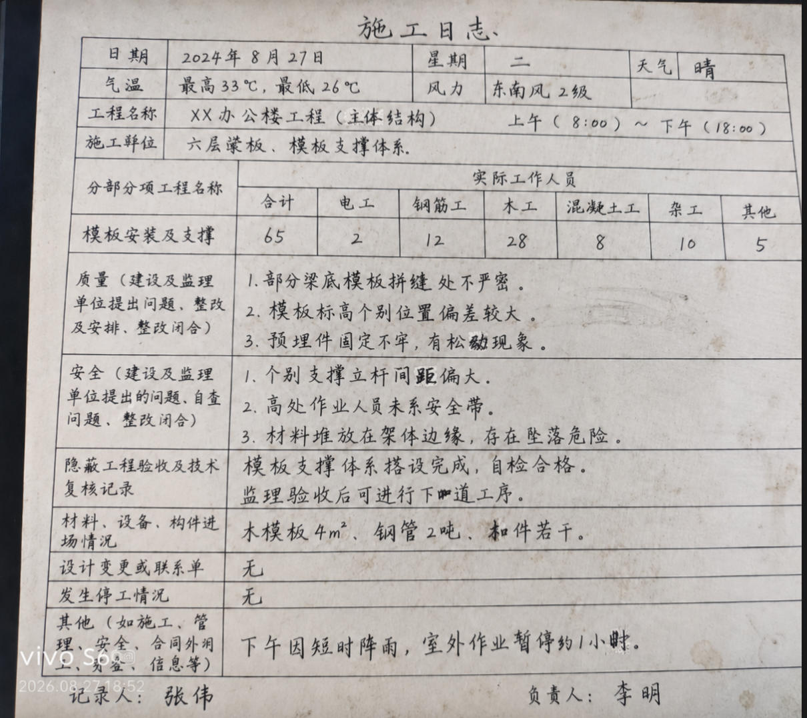
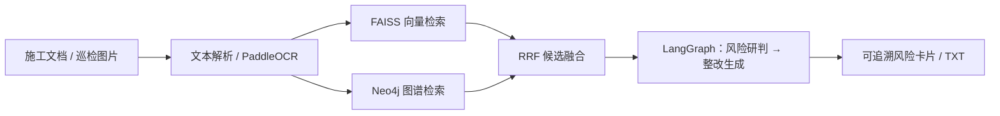

# SafeON · 施工安全知识智能研判平台

从施工文档与巡检图片识别危险因素，定位到文献页码，并生成可下载的整改建议。

## 运行示例 · 一张施工日志如何变成整改建议

| 输入：施工日志 | 输出：风险研判 |
| :--- | :--- |
| <a href="docs/examples/scenario-03.jpg"></a> | **最高等级：较大风险 · 3 个工程项目 · 6 项危险因素**<br><br>**日志原文：**“高处作业人员未系安全带”<br>**研判：**高处作业未系安全带 · 人员因素<br>**检索依据：**JGJ/T 429-2018《建筑施工易发事故防治安全标准》，知识库页码 **P37–P39**<br>**整改措施：**发现未系安全带，停止相关作业并重新进行安全交底；设置安全带挂设点，检查挂钩与挂点的连接可靠性。 |

<details>
<summary>展开另一项风险：支撑脚手架立杆间距过大</summary>

- **日志原文：**“个别支撑立杆间距偏大”
- **等级与类型：**较大风险 · 管理因素
- **检索依据：**GB 51210-2016《建筑施工脚手架安全技术统一标准》，知识库页码 **P101–P105**
- **整改措施：**对照专项施工方案逐跨测量立杆间距，记录实测值并标记不合格点位。

</details>

以上为一次运行的结果节选。依据页码来自知识库，不是输入图片的页码。

| 功能 | 输入 | 输出 |
| --- | --- | --- |
| 平台总览与模型配置 | Neo4j 知识库、模型设置 | 实体与关系规模、风险分布、模型连接状态 |
| 知识抽取与图谱展示 | PDF、Word | 危险因素、项目、风险等级与来源页码；交互图谱及 CSV |
| 风险研判与整改建议 | PDF、Word、JPG、PNG | 按风险排序的清单、依据文献与页码、整改措施与 TXT 报告 |

## 工作流程



抽取流程与在线研判独立：抽取结果可导出 CSV，并在页面预览关系图；它不会自动写入现有知识库。风险研判把检索依据和生成的整改措施分开呈现，结果需结合现场实际复核。

## 本地运行（Windows x64）

需要 Python 3.10、Node.js 22（至少 22.13）和 Neo4j Desktop。接下来的示例用**合成数据**，不用原项目的知识库。Neo4j Desktop 内启动本地实例，为本项目创建一个空的 `safeon` 数据库。若只能使用默认的 `neo4j` 库，必须使用独立且空的新实例。

在仓库根目录打开 PowerShell：

```powershell
py -3.10 -m venv .venv
.\.venv\Scripts\python.exe -m pip install --upgrade pip
.\.venv\Scripts\python.exe -m pip install -r requirements.txt
npm.cmd --prefix Front-end ci

# 生成演示图谱、FAISS 索引和合成示例。首跑下载 BGE 模型权重。
.\.venv\Scripts\python.exe -X utf8 prepare_demo.py

# Neo4j 密码不回显，存入当前 Windows 用户的凭据库。
.\.venv\Scripts\python.exe -X utf8 safeon.py configure
.\.venv\Scripts\python.exe -X utf8 safeon.py import-neo4j
```

导入器只接受空库，拒绝覆盖已有数据。不要使用系统数据库，也不要清空现有库来做演示。

分别在两个终端启动：

```powershell
# 终端 A
.\.venv\Scripts\python.exe -X utf8 safeon.py backend

# 终端 B
npm.cmd --prefix Front-end run dev -- --host 127.0.0.1 --port 5173 --strictPort
```

打开 [SafeON 前端](http://127.0.0.1:5173/)，或访问 [后端健康检查](http://127.0.0.1:8000/api/v1/health)。可在模型设置页输入自己的 DeepSeek API Key，完成连接测试后，上传生成的 `demo_generated/模拟巡检记录.docx` 查看抽取和研判。也可用同目录的 JPG 验证图片研判；PaddleOCR 第一次运行会下载它的模型文件。首页和本地健康检查不需要 DeepSeek Key。Qwen3-8B 是预留项。

## 代码结构与数据边界

- `Front-end/`：React 前端，开发环境代理到本地后端。
- `backend/`：FastAPI 接口、任务处理、模型设置。
- `agent/`：上传文件解析、PaddleOCR、FAISS / Neo4j 检索及 LangGraph 工作流。
- `prepare_demo.py` / `neo4j_transfer.py`：生成演示知识库、校验和导入图谱。

仓库包含上面的单张运行示例，不包含生产知识库、完整原始文献集、模型权重或 API 密钥。应用默认只在本机运行；对外部署前需要另行设计认证、授权、上传限额与日志策略。
